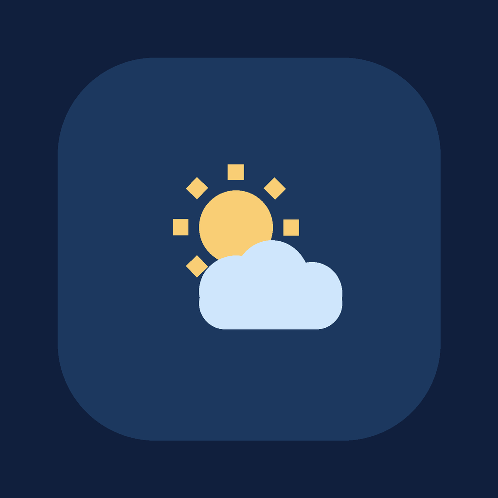
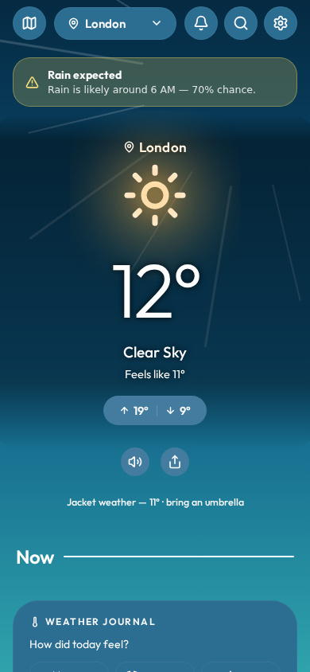
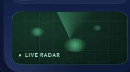
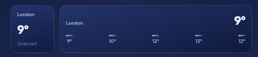

<div align="center">



<h1>MU Weather</h1>

<strong>See when it will rain and plan around it.</strong>

Material You weather for Android

<p>
  <strong><a href="https://github.com/Avithegod2010/MU-Weather/releases/download/v1.5.0/app-universal-release.apk">Download APK v1.5.0</a></strong> ·
  <a href="#install">Install options</a> ·
  <a href="#screenshots">Screenshots</a> ·
  <a href="https://avithegod2010.github.io/MU-Weather/">Project website</a>
</p>

<sub>No account, ads, tracking or API key</sub>

</div>

<a name="-screenshots"></a>

## Screenshots

<p align="center">
  <a href="scripts/visual/results/halo-shots/clear-day-ocean-A.png"></a>
  <a href="scripts/visual/results/detail/home-hourly-forecast.png"></a>
</p>

<p align="center"><sub>Today’s weather · Hourly forecast</sub></p>

<p align="center">
  <a href="radar-preview.png"></a>
  <a href="widget-preview.png"></a>
</p>

<p align="center"><sub>Rain radar and home-screen widget previews from the project website</sub></p>

<a name="-features"></a>

## What you can do

- **Plan your week.** Check a 16-day forecast, hourly conditions and the next chance of rain.
- **See rain move.** Play and scrub the radar timeline. See official warnings in supported regions.
- **Make it yours.** Pick from five home-screen widgets and use Material You colours on Android 12 and newer.

## Install

Download the [universal APK](https://github.com/Avithegod2010/MU-Weather/releases/download/v1.5.0/app-universal-release.apk) to your Android phone and open it to install. If you know your phone’s architecture, choose a smaller APK from the [release page](https://github.com/Avithegod2010/MU-Weather/releases/tag/v1.5.0).

<a name="-privacy--permissions"></a>

## Privacy and offline use

MU Weather fetches weather directly from public providers and sends them the coordinates you’re viewing. Settings, saved cities and cached forecasts stay on your device.

- **Location is optional.** Look up and save a city to check its weather without location permission.
- **Cached weather works offline.** A stale label tells you when the last saved forecast is out of date.
- **Alerts are opt-in.** Check **Settings → Alerts → History** to see what happened when you expected a notification.

<sub>Weather data can be delayed or inaccurate. Use your local weather authority for safety-critical decisions.</sub>

<a name="-getting-started"></a>
<a name="-building-an-apk"></a>

## Run from source

<details>
<summary>Local development and tests</summary>

Install Node 20 or newer and Expo Go on your Android device. From the repository root, run:

```bash
npm ci
npx expo start
```

Scan the QR code in Expo Go. Use `npx tsc --noEmit` for type checks and `npm test -- --ci` for unit tests. [APK build instructions](REFERENCE.md#building-an-apk)

</details>

<a name="-data-sources--attribution"></a>
<a name="-languages"></a>
<a name="-roadmap"></a>
<a name="-contributing"></a>
<a name="-license"></a>

## Project links

[All features](REFERENCE.md#features) · [Data sources and permissions](REFERENCE.md#data-sources--attribution) · [Languages](REFERENCE.md#languages) · [FAQ](REFERENCE.md#faq) · [Changelog](CHANGELOG.md) · [MIT license](LICENSE)
