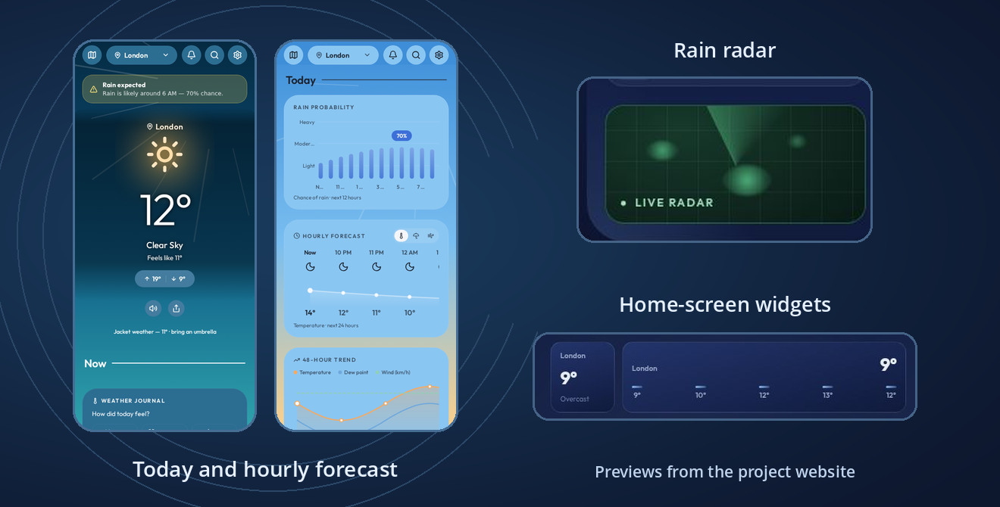

<h1>MU Weather</h1>

<strong>See when it will rain and plan around it.</strong>

Material You weather for Android

  <strong><a href="https://github.com/Avithegod2010/MU-Weather/releases/download/v1.5.0/app-universal-release.apk">Download APK v1.5.0</a></strong> ·
  <a href="#install">Install options</a> ·
  <a href="https://avithegod2010.github.io/MU-Weather/">Project website</a>

No account, ads, tracking or API key

## What you can do

- **Plan your week.** Check a 16-day forecast, hourly conditions and the next chance of rain.
- **See rain move.** Play and scrub the radar timeline. See official warnings in supported regions.
- **Make it yours.** Pick from five home-screen widgets and use Material You colours on Android 12 and newer.

## Install

Download the [universal APK](https://github.com/Avithegod2010/MU-Weather/releases/download/v1.5.0/app-universal-release.apk) to your Android phone and open it to install. If you know your phone’s architecture, choose a smaller APK from the [release page](https://github.com/Avithegod2010/MU-Weather/releases/tag/v1.5.0).

## Screenshots

[Today forecast](scripts/visual/results/halo-shots/clear-day-ocean-A.png) · [Hourly forecast](scripts/visual/results/detail/home-hourly-forecast.png) · [Radar preview](radar-preview.png) · [Widget preview](widget-preview.png)

## Privacy and offline use

MU Weather fetches weather directly from public providers. It sends the coordinates you’re viewing to those providers and keeps settings and cached forecasts on your device. You can use saved cities without granting location access. [Data sources and permissions](REFERENCE.md#data-sources--attribution)

## Project links

[Full features](REFERENCE.md#features) · [Languages](REFERENCE.md#languages) · [FAQ](REFERENCE.md#faq) · [Developer setup](REFERENCE.md#getting-started) · [Changelog](CHANGELOG.md) · [MIT license](LICENSE)
