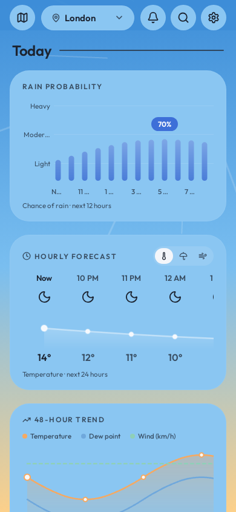
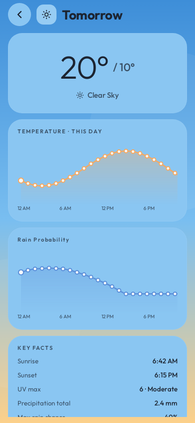
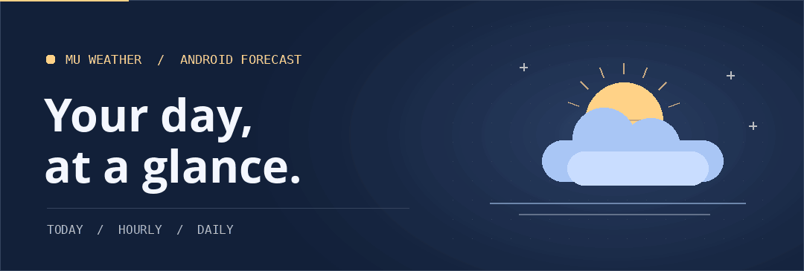

<div align="center">

<h1>MU Weather</h1>

<p><strong>See the weather now and when it’s likely to change.</strong></p>

<p><strong><a href="https://github.com/Avithegod2010/MU-Weather/releases/download/v1.5.0/app-universal-release.apk">⬇️ Download APK v1.5.0</a></strong> · <a href="#screenshots">🌤️ See the forecasts</a> · <a href="https://avithegod2010.github.io/MU-Weather/">🌐 Project website ↗</a></p>

<p><sub>Material You weather for Android · No account, ads, tracking or API key</sub></p>

</div>

<a name="-screenshots"></a>

<a name="screenshots"></a>

## 🌤️ Screenshots

<p align="center">
  <a href="scripts/visual/results/halo-shots/clear-day-ocean-A.png"></a>
  <a href="scripts/visual/results/detail/home-hourly-forecast.png"></a>
  <a href="scripts/visual/results/detail/day-detail-top.png"></a>
</p>

<details>
<summary>Project illustration</summary>

<picture>
  <source media="(prefers-reduced-motion: reduce)" srcset="readme-hero.png" />
  
</picture>

</details>

<p align="center"><sub>Today’s weather · Hourly forecast · Day detail</sub></p>

<a name="-features"></a>

<a name="what-you-can-do"></a>

## 📅 What you can do

| ☀️ See what’s ahead | 🌧️ Track rain | 🎨 Make it yours |
| --- | --- | --- |
| Check the 16-day forecast, hourly conditions and the next chance of rain. | Play or scrub the radar timeline. See official warnings in supported regions. | Choose from five widgets and use Material You colours on Android 12 or newer. |

<a name="install"></a>

## ⬇️ Install

Download the [universal APK](https://github.com/Avithegod2010/MU-Weather/releases/download/v1.5.0/app-universal-release.apk) to your Android phone and open it to install. If you know your phone’s architecture, choose a smaller APK from the [release page](https://github.com/Avithegod2010/MU-Weather/releases/tag/v1.5.0).

<a name="-privacy--permissions"></a>

<a name="privacy-and-offline-use"></a>

## 🔒 Privacy and offline use

MU Weather fetches weather directly from public providers and sends them the coordinates you’re viewing. Settings, saved cities and cached forecasts stay on your device.

- **Location is optional.** Look up and save a city to check its weather without location permission.
- **Cached weather works offline.** A stale label tells you when the last saved forecast is out of date.
- **Alerts are opt-in.** Check **Settings → Alerts → History** to see what happened when you expected a notification.

> [!IMPORTANT]
> Use your local weather authority for safety-critical decisions. Forecast data can be delayed or inaccurate.

<a name="-getting-started"></a>
<a name="-building-an-apk"></a>

<a name="run-from-source"></a>

## 🛠️ Run from source

<details>
<summary>Local development and tests</summary>

Install Node 20 or newer and Expo Go on your Android device. From the repository root, run:

```bash
npm ci
npx expo start
```

Scan the QR code in Expo Go. Use `npx tsc --noEmit` for type checks and `npm test -- --ci` for unit tests. [APK build instructions](REFERENCE.md#building-an-apk)

</details>

<a name="-data-sources--attribution"></a>
<a name="-languages"></a>
<a name="-roadmap"></a>
<a name="-contributing"></a>
<a name="-license"></a>

## Project links

[All features](REFERENCE.md#features) · [Data sources and permissions](REFERENCE.md#data-sources--attribution) · [Languages](REFERENCE.md#languages) · [FAQ](REFERENCE.md#faq) · [Changelog](CHANGELOG.md) · [MIT license](LICENSE)
